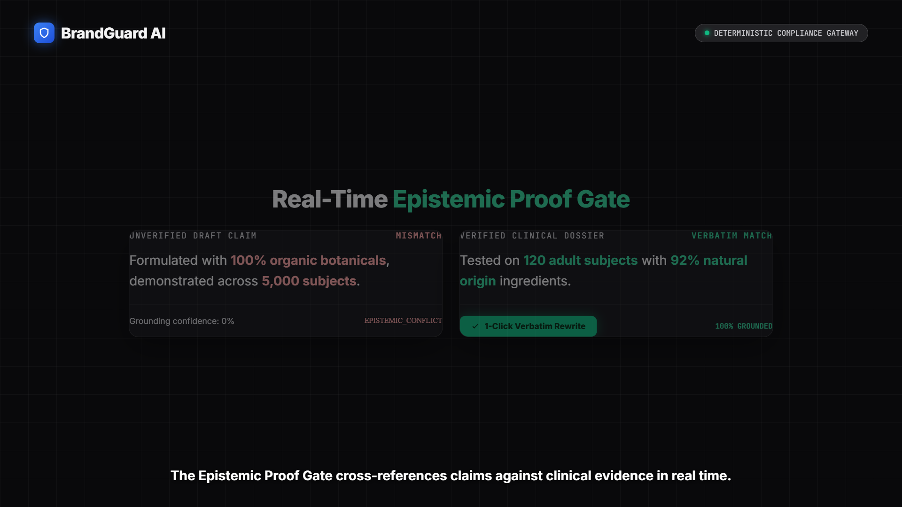

# BrandGuard AI
**Explainable Brand Governance, Source-Anchored Claim Verification & Tamper-Evident Audit Workspace**

- **Live Production App:** [https://brandguard-ai-970.netlify.app](https://brandguard-ai-970.netlify.app)
- **GitHub Repository:** [https://github.com/Rudra4451/brandguard-ai](https://github.com/Rudra4451/brandguard-ai)
- **Competition:** Inkloom AI Challenge — We Code Coders
- **Solo Participant:** Rudra Pratap Swain

---

## Launch Video Showcase (Narrated by Kokoro AI)

[](brag-output/brag.mp4)

> 🎬 **Watch Video**: [Download or Play `brag-output/brag.mp4`](brag-output/brag.mp4)  
> *Audio: High-definition voiceover generated via Kokoro-82M (`am_adam`) + Sascha Ende Lo-Fi beat + UI sound effects.*

<video src="brag-output/brag.mp4" controls width="100%" poster="brag-output/brag-poster.png"></video>

## Architecture & Core Capabilities

BrandGuard AI replaces subjective, slow copy reviews and hallucination-prone "brand scores" with a deterministic + evidence-gated workflow: no marketing claim can ever be marked verified unless an approved primary source excerpt is cited verbatim alongside it, and no human approval can survive a post-approval edit.

1. **Deterministic 0ms AST Lexical Linter:** Sub-5ms client-side regex & token evaluation for banned phrases, required disclaimers, trademark syntax, and channel character limits.
2. **Epistemic RAG 3-State Claim Verifier:** Two-stage verbatim proof gate classifying claims into `SUPPORTED`, `CONFLICT_FOUND`, or `UNVERIFIED` against registered brand facts.
3. **Prescriptive Intent-Safe Rewrites:** Inline surgical replacements preserving author CTA and voice.
4. **Cryptographic SHA-256 Approval Gate:** Sign-off locked to `SHA256(draftText + ruleVersion + factStoreVersion + snapshot)`. Keystroke edits instantly revoke sign-off.
5. **Tamper-Evident Audit Event Chain:** $H_n = \text{SHA256}(H_{n-1} + \dots)$ logging all governance evaluations, overrides, and approvals into a print-calibrated A4 PDF compliance report.

---

## Local Development & Testing

```bash
# Install dependencies
npm install

# Run unit and integration tests (87 tests)
npm test

# Run development server
npm run dev

# Run production build
npm run build
```

## Environment Configuration

Copy `.env.example` to `.env` and supply your Gemini API key (serverless gateway only, never exposed to browser bundles):

```env
GEMINI_API_KEY=your_gemini_api_key_here
```
